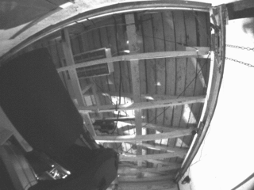
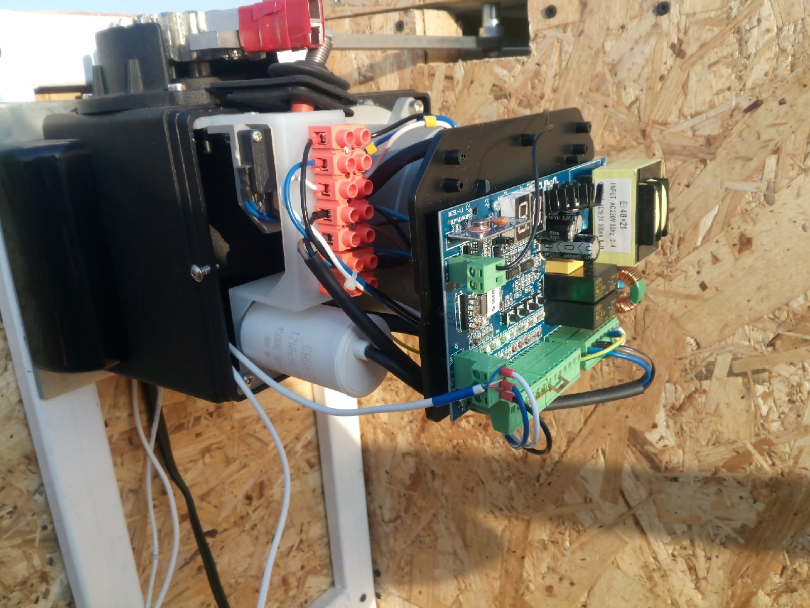
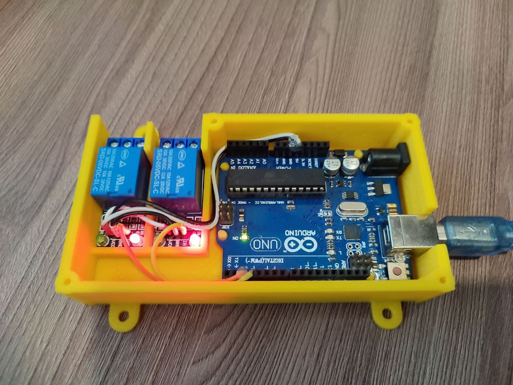

# Roll Roof — INDI roll-off roof controller

[](https://github.com/miksrv/indi-rollroof-controller/actions/workflows/checks.yml)
[](https://github.com/miksrv/indi-rollroof-controller/releases)
[](LICENSE)

**Roll Roof** is an [INDI 2.x](https://indilib.org/) dome driver (`indi_rollroof`) and Arduino firmware for a roll-off observatory roof driven by a **sliding-gate motor**. The gate controller needs only two signals, **OPEN** and **CLOSE**, so the whole electronics is an Arduino UNO, two relays and four switches. The roof moves only when the telescope is parked, checked both by the mount driver and by reed switches on the mount.

Works with KStars / Ekos, the INDI Web Manager and any other INDI client. A fork of [INDI Aldiroof](https://github.com/dokeeffe/indi-aldiroof) by Derek O'Keeffe.



## Features

- **Two-signal drive**: a sliding-gate motor controller does the travel, the Arduino only pulses the OPEN or CLOSE relay for 800 ms.
- **Mount interlock in software and hardware**: the driver refuses to move the roof unless the mount driver reports a settled park, and the firmware ignores OPEN/CLOSE unless both park reed switches are closed. See [Safety interlock](#safety-interlock).
- **Position feedback**: fully open and fully closed limit switches; the roof state is read fresh on every request.
- **Standard INDI dome**: park/unpark and motion from Ekos, the Scheduler, the WatchDog or the INDI Control Panel; *Mount Policy* / *Dome Policy* keep the mount and the roof from colliding.
- **Simple electronics**: Arduino UNO, two 30 A relay modules, four switches, one USB cable. Firmata over serial, no custom protocol stack.
- **Ready to print**: a 3D-printable case for the board and relays in [`models/`](models/).



## How it works

```
 KStars / Ekos ──INDI──▶ Roll Roof driver ──Firmata/USB──▶ Arduino UNO ──relay pulse──▶ gate motor controller
                             │                                  ▲
                             │ snoops TELESCOPE_PARK             │ limit switches (open / closed)
                             ▼                                  │ park reed switches (RA / DEC)
                        mount driver                        roof and mount
```

1. A client parks or unparks the roof (`DOME_PARK`) or presses a *Motion* button (`DOME_MOTION`).
2. The driver checks that the mount driver reports **PARK / Ok** and queries the Arduino for the roof and reed switch state.
3. Only if both agree that the telescope is parked, the driver sends `OPEN` or `CLOSE`; the firmware checks the reed switches again and pulses the relay.
4. The gate controller runs the travel; the driver waits for the target limit switch (up to 19 s) and reports the new roof state.

## Hardware

| Part | Notes |
| ---- | ----- |
| Arduino UNO (or compatible) | Runs the Firmata-based firmware at 57600 baud |
| 2 × 30 A relay module | One pulses OPEN, one pulses CLOSE on the gate motor controller |
| 2 × limit switch | Roof fully open, roof fully closed |
| 2 × reed switch | Telescope park position on the RA and DEC axes |
| Linux host with INDI 2.x | Raspberry Pi, mini PC, anything that runs the INDI server |
| 3D-printed case (optional) | STL files and labels in [`models/`](models/) |

Pinout, signal levels, the controller protocol (`OPEN` / `CLOSE` / `ABORT` / `QUERY`) and troubleshooting are in [documentation/hardware.md](documentation/hardware.md).



Before the first run make sure that:

- the limit switches detect the fully open and fully closed states and the roof cannot overrun them (a lost mechanical stop lets the roof travel past the open switch);
- the reed switches close only at the mount's park position, and that position matches the park position stored in the mount driver.

## Getting started

### 1. Flash the firmware

1. Open the [Arduino IDE](https://www.arduino.cc/en/software) and install the **Firmata** library.
2. Open `arduino-firmware/RoofController/RoofController.ino` and upload it to the board.

Keep the sketch name `RoofController`: Firmata reports it as the firmware name, and the driver refuses to work with a board whose firmware name does not contain it.

### 2. Build and install the driver

The driver needs the INDI 2.x development files and libnova. On Ubuntu 26.04 the [INDI PPA](https://launchpad.net/~mutlaqja/+archive/ubuntu/ppa) has the current INDI 2.x release; the distribution packages of older Ubuntu releases are INDI 1.x, which the driver no longer supports (CMake stops with "INDI 2.x is required").

```bash
sudo add-apt-repository ppa:mutlaqja/ppa
sudo apt-get update
sudo apt-get install -y cmake libindi-dev libnova-dev

git clone https://github.com/miksrv/indi-rollroof-controller.git
cd indi-rollroof-controller
./indi-driver/build.sh
```

The script configures the driver with CMake in `indi-driver/build`, compiles it and runs `sudo make install`, which installs:

- `/usr/bin/indi_rollroof` — the driver;
- `/usr/share/indi/indi_rollroof.xml` — its description, so **Roll Roof** appears under *Domes* in the INDI Web Manager and Ekos without editing `drivers.xml`.

To build by hand: `cmake -B build indi-driver/indi-rollroof && cmake --build build && sudo cmake --install build` (the install prefix defaults to `/usr`).

### 3. Configuring the Driver

Add **Roll Roof** (Dome) to your INDI Web Manager / Ekos profile together with the mount driver, then:

1. **Roll Roof → Connection**: set the port to the Arduino. Prefer the stable `/dev/serial/by-id/usb-Arduino...` path over `/dev/ttyACM0`, and turn *Auto Search* off so it never grabs the mount's port.
2. **Roll Roof → Options → Snoop devices → Telescope** (`ACTIVE_TELESCOPE`): the mount driver name, e.g. `EQMod Mount`. The interlock watches this device.
3. **Roll Roof → Options → Mount Policy**: `Mount locks` — the roof will not close while the mount is unparked.
4. **Mount → Options → Dome Policy**: `Dome locks` and **ACTIVE_DOME** = `Roll Roof` — the mount will not unpark while the roof is closed.
5. Save the configuration of both drivers.

Parking the roof (`DOME_PARK`) closes it, unparking opens it. The roof can also be moved with the *Motion* buttons (`DOME_MOTION`); the same interlock applies.

## Safety Interlock

At the park position the telescope must clear the moving roof; in any other position the roof would hit it. The roof therefore moves **only** when **all** of the following are true:

1. The mount driver set as `ACTIVE_TELESCOPE` reports `TELESCOPE_PARK` = **PARK** with state **Ok**. Anything uncertain counts as *not parked*: no report yet, mount driver not running or disconnected, parking/unparking in progress (Busy), or Alert.
2. Both park reed switches (RA and DEC) are closed. The firmware checks this as well and ignores OPEN/CLOSE otherwise.
3. The roof controller answered the status query.

Otherwise the command is refused (`DOME_PARK` / `DOME_MOTION` go to Alert) and the reason is logged, e.g. *"The telescope is NOT PARKED in software (or its park state is unknown), the roof cannot be moved!"*.

Notes:

- After the mount refuses to unpark (because of *Dome locks*), its park vector stays in Alert, so the roof stays blocked until the mount driver reports a settled park again (e.g. after reconnecting it). This is intentional.
- The driver only refuses unsafe commands; it never parks the mount by itself. For automatic shutdown (weather, client loss) let the Ekos Scheduler or the INDI WatchDog park the mount **first** and the roof **second**.
- A travel cannot be stopped once started: the gate controller runs it to the end. `ABORT` only stops the driver waiting for the limit switch; it is not an emergency stop.
- The motor run is limited to 19 s; if the target limit switch is not reached by then, the driver stops waiting and reports the roof state as unknown.

## Project structure

```
indi-driver/
  build.sh                  configure, build and sudo make install
  indi-rollroof/
    rollroof.cpp, .h        the driver (INDI::Dome subclass)
    indi_rollroof.xml.cmake driver description for the INDI Web Manager / Ekos
    libfirmata/             bundled Firmata client
arduino-firmware/
  RoofController/           the sketch (StandardFirmata-based, 57600 baud)
documentation/
  hardware.md               pinout, signal levels, protocol, troubleshooting
models/                     3D-printable case and labels
CHANGELOG.md                what changed in each release
```

## Development

```bash
# Driver: build only (needs libindi-dev and libnova-dev, see above)
cmake -B build indi-driver/indi-rollroof && cmake --build build

# Firmware: compile check, as in CI
arduino-cli core install arduino:avr && arduino-cli lib install Firmata
arduino-cli compile --fqbn arduino:avr:uno arduino-firmware/RoofController
```

Every pull request runs the *Checks* workflow (`.github/workflows/checks.yml`): the driver is built and installed against INDI 2.x when `indi-driver/` changed, the firmware is compiled for the Arduino Uno when `arduino-firmware/` changed, and the final *Checks passed* job, the only status check `main` requires, fails if any of those builds failed. There are no unit tests: real verification happens on the observatory host with the hardware, and the roof is only moved with the owner watching.

Releases follow [CHANGELOG.md](CHANGELOG.md): the version lives in `indi-driver/indi-rollroof/CMakeLists.txt`, every bump gets a section in the changelog and a `vX.Y.Z` tag with a [GitHub release](https://github.com/miksrv/indi-rollroof-controller/releases).

## Contributing

Bug reports and pull requests are welcome. Fork the repository, create a branch, and open a pull request against `main`. Changes to the driver's `Move()` checks or to the firmware's reed switch check are safety-relevant: please explain in the PR why the roof still cannot hit the telescope.

## Acknowledgments

Based on [INDI Aldiroof](https://github.com/dokeeffe/indi-aldiroof) by Derek O'Keeffe and built on the [INDI Library](https://indilib.org/).

## License

[MIT](LICENSE).
