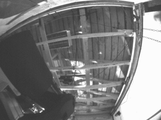
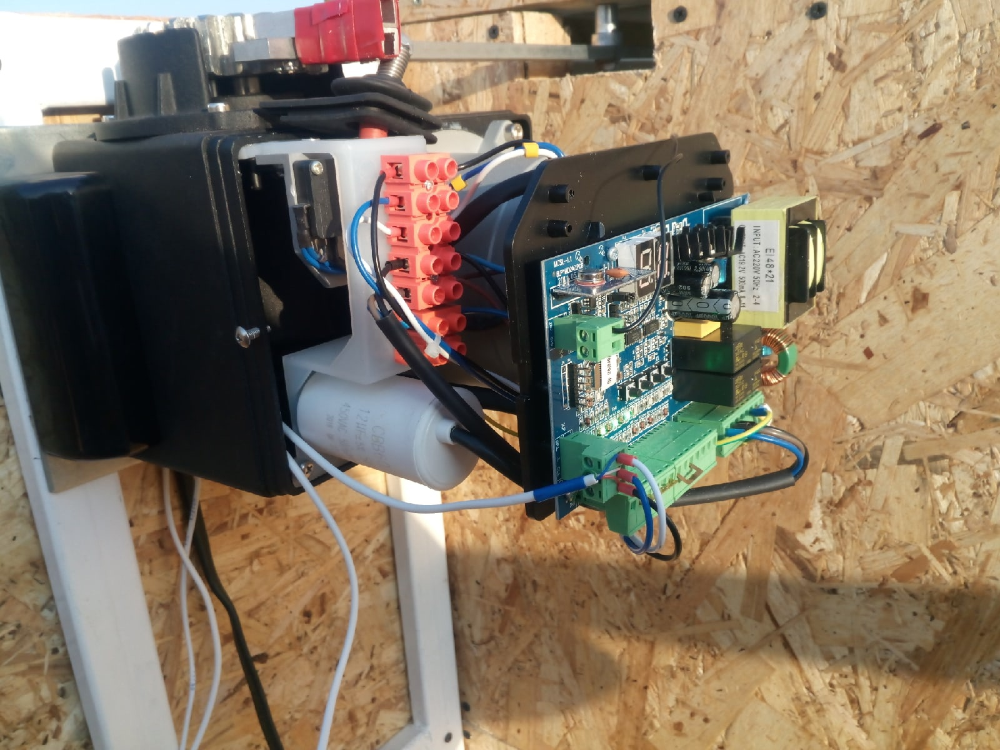
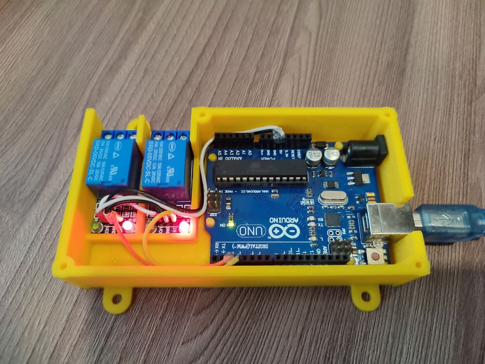

# Observatory Roof Controller

[](https://github.com/miksrv/indi-rollroof-controller/actions/workflows/arduino-check.yml) 
[](https://github.com/miksrv/indi-rollroof-controller/actions/workflows/cmake-multi-platform.yml)

A fork of the original [INDI Aldiroof](https://github.com/dokeeffe/indi-aldiroof) project by Derek O'Keeffe, designed for simplified roll-off roof mechanisms requiring only two signals: **OPEN** and **CLOSE**.

This project includes an [INDI](http://indilib.org/) driver (`indi_rollroof`, device name **Roll Roof**) and Arduino firmware to manage a roll-off roof for astronomical observatories. The driver targets **INDI 2.x**.



## Key Features

- **Efficient Roof Operation**: Control a motor-driven sliding gate reducer with just two signals.
- **Hardware Safety**: Limit switches for the roof position and reed switches for the telescope park position.
- **Mount Interlock**: The roof moves only when the mount is parked both in software (mount driver) and in hardware (reed switches) — see [Safety interlock](#safety-interlock).
- **Simple Electronics**: Two 30A relays connected to an Arduino handle all roof movements.
- **Seamless Communication**: Uses the Firmata protocol for interaction between the Arduino and the INDI driver.



## Hardware Requirements

### Components
- **Microcontroller**: Arduino UNO (or compatible board).
- **Relays**: Two 30A relay modules.
- **Sensors**: Two roof limit switches (fully open, fully closed) and two reed switches for the telescope park position (RA and DEC axes).
- **Server**: A Linux machine running INDI 2.x.
- *(Optional)* A custom 3D-printed case for the hardware (`models/`).

Pinout, signal logic, the controller protocol and troubleshooting tips are in [documentation/hardware.md](./documentation/hardware.md).

## Software Setup

### 1. Flashing the Arduino Firmware
1. Open the [Arduino IDE](https://www.arduino.cc/en/software) and install the **Firmata** library.
2. Connect your Arduino board to your computer.
3. Open `arduino-firmware/RoofController/RoofController.ino` and upload the firmware.

Keep the sketch name `RoofController`: Firmata reports it as the firmware name, and the driver refuses to work with a board whose firmware name does not contain `RoofController`.

### 2. Building and Installing the INDI Driver

1. **Install the dependencies** (INDI 2.x development files and libnova, whose headers INDI includes; on Ubuntu the [INDI PPA](https://launchpad.net/~mutlaqja/+archive/ubuntu/ppa) has the current release):
   ```bash
   sudo add-apt-repository ppa:mutlaqja/ppa
   sudo apt-get update
   sudo apt-get install -y cmake libindi-dev libnova-dev
   ```

2. **Clone the repository**:
   ```bash
   git clone https://github.com/miksrv/indi-rollroof-controller.git
   cd indi-rollroof-controller
   ```

3. **Build and install the driver**:
   ```bash
   ./indi-driver/build.sh
   ```
   The script configures the driver with CMake in `indi-driver/build`, compiles it and runs `sudo make install`, which installs:
   - `/usr/bin/indi_rollroof` — the driver;
   - `/usr/share/indi/indi_rollroof.xml` — its description, so **Roll Roof** appears under *Domes* in the INDI Web Manager and Ekos without editing `drivers.xml`.

   To build by hand: `cmake -B build indi-driver/indi-rollroof && cmake --build build && sudo cmake --install build` (the install prefix defaults to `/usr`).

### 3. Configuring the Driver

Add **Roll Roof** (Dome) to your INDI Web Manager / Ekos profile together with the mount driver, then:

1. **Roll Roof → Connection**: set the port to the Arduino. Prefer the stable `/dev/serial/by-id/usb-Arduino...` path over `/dev/ttyACM0`, and turn *Auto Search* off so it never grabs the mount's port.
2. **Roll Roof → Options → Snoop devices → Telescope** (`ACTIVE_TELESCOPE`): the mount driver name, e.g. `EQMod Mount`. The interlock watches this device.
3. **Roll Roof → Options → Mount Policy**: `Mount locks` — the roof will not close while the mount is unparked.
4. **Mount → Options → Dome Policy**: `Dome locks` and **ACTIVE_DOME** = `Roll Roof` — the mount will not unpark while the roof is closed.
5. Save the configuration of both drivers.

Parking the roof (`DOME_PARK`) closes it, unparking opens it. The roof can also be moved with the *Motion* buttons (`DOME_MOTION`); the same interlock applies.

## Safety Interlock

At the park position the telescope must clear the moving roof; in any other position the roof would hit it. The roof therefore moves **only** when **all** of the following are true:

1. The mount driver set as `ACTIVE_TELESCOPE` reports `TELESCOPE_PARK` = **PARK** with state **Ok**. Anything uncertain counts as *not parked*: no report yet, mount driver not running or disconnected, parking/unparking in progress (Busy), or Alert.
2. Both park reed switches (RA and DEC) are closed. The firmware checks this as well and ignores OPEN/CLOSE otherwise.
3. The roof controller answered the status query.

Otherwise the command is refused (`DOME_PARK` / `DOME_MOTION` go to Alert) and the reason is logged, e.g. *"The telescope is NOT PARKED in software (or its park state is unknown), the roof cannot be moved!"*.

Notes:
- After the mount refuses to unpark (because of *Dome locks*), its park vector stays in Alert, so the roof stays blocked until the mount driver reports a settled park again (e.g. after reconnecting it). This is intentional.
- The driver only refuses unsafe commands; it never parks the mount by itself. For automatic shutdown (weather, client loss) let the Ekos Scheduler or the INDI WatchDog park the mount **first** and the roof **second**.
- The motor run is limited to 19 s; if the target limit switch is not reached by then, the driver stops waiting and reports the roof state as unknown.

## Wiring and Hardware Setup
- Wire the Arduino with relays, sensors, and motor as outlined in the wiring diagram below and in [documentation/hardware.md](./documentation/hardware.md).
- Ensure that:
  - Limit switches detect the fully open and fully closed states, and the roof cannot overrun them (a lost mechanical stop lets the roof travel past the open switch).
  - Reed switches close only at the mount's park position, and that this position matches the park position stored in the mount driver.



## Contributing

Contributions are welcome! If you encounter bugs or have suggestions for improvements:
1. Fork the repository.
2. Create a feature branch.
3. Submit a pull request.

## Acknowledgments

This project is based on the work of [Derek O'Keeffe](https://github.com/dokeeffe/indi-aldiroof) and leverages the powerful [INDI Library](http://indilib.org/).  
Special thanks to the open-source community for enabling projects like this.

### License
This project is licensed under the [MIT License](./LICENSE).
